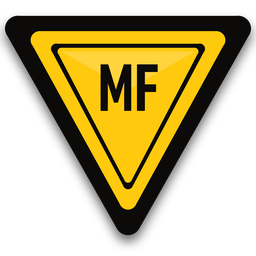
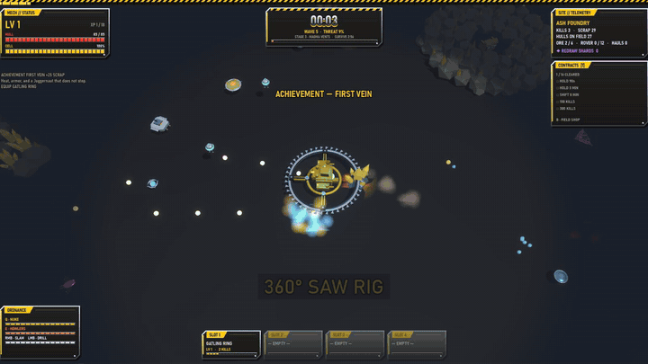
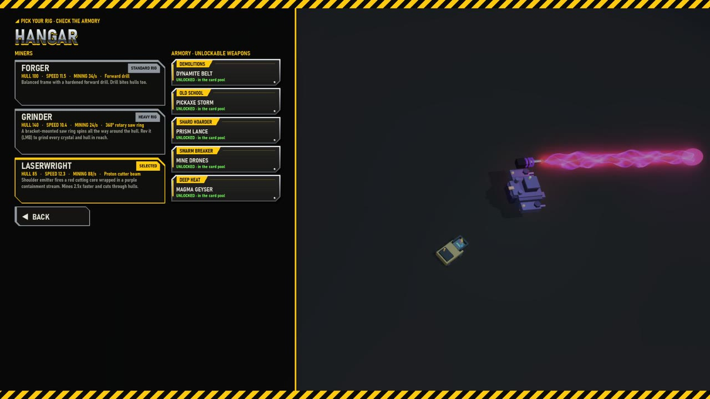
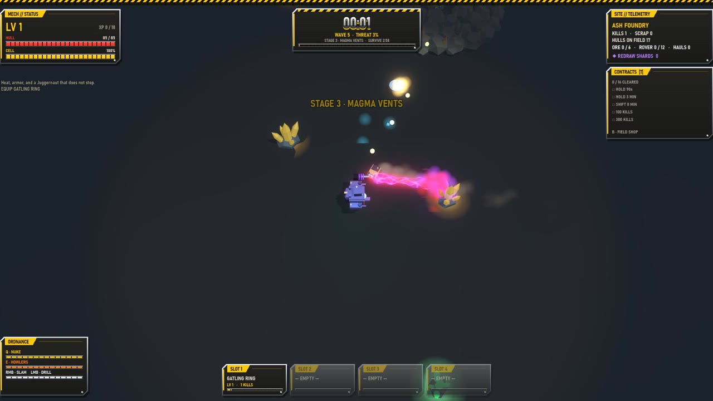
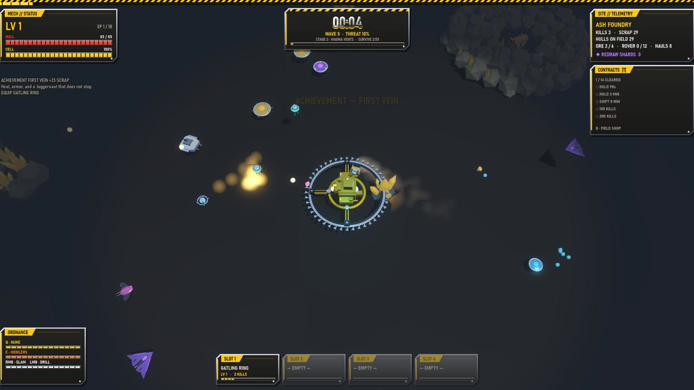
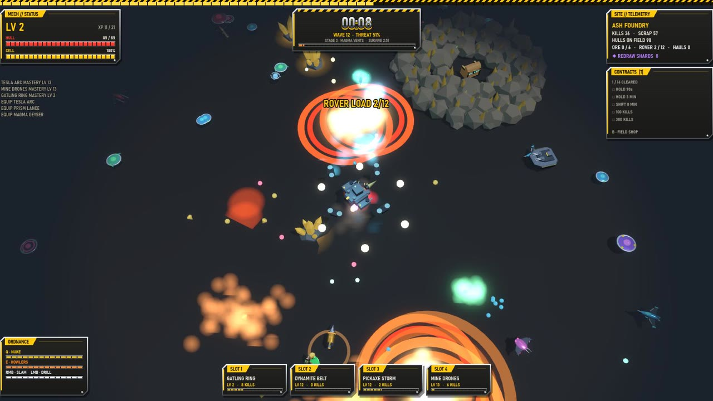
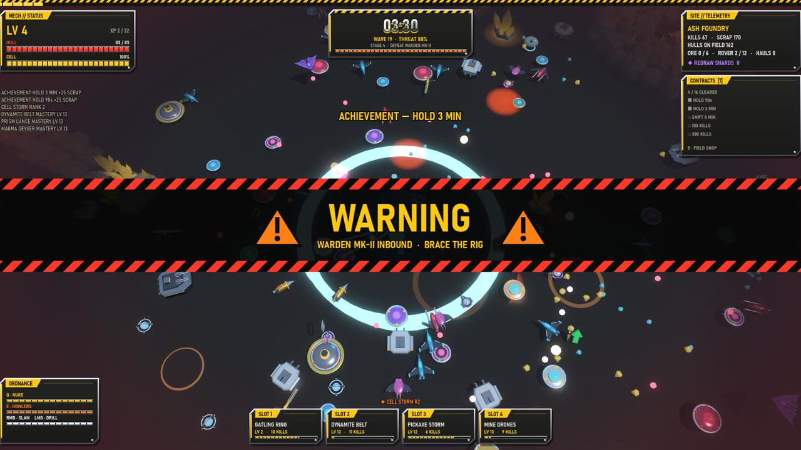
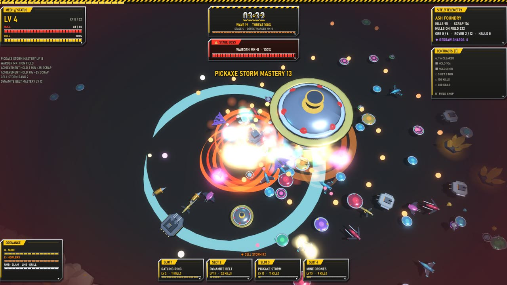

  

<h1 align="center">MINEFORGERS</h1>

<b>Deep-core mining survival</b> — drill the crystal fields, haul the ore, and hold the line against an endless alien swarm.

  <a href="https://github.com/tattooinmtl/MineForgers-Releases/releases/latest/download/MineForgers.exe"><b>⬇ Download MineForgers.exe (Windows, 64-bit)</b></a>
  &nbsp;·&nbsp;
  <a href="https://github.com/tattooinmtl/MineForgers-Releases/releases">All releases</a>

  

## How to play
1. Download **MineForgers.exe** — one file, nothing to install.
2. Double-click it.
3. First launch only: if Windows shows *"Windows protected your PC"*, click **More info → Run anyway**. (The game isn't code-signed yet.)

Your progress is saved automatically in `%APPDATA%\Godot\app_userdata\MineForgers\`.

## Game modes
**Challenge** — six stages. Survive the clock, then break the stage boss: The Warden, The Broodmother, The Juggernaut, Warden Mk-II, The Brood Queen and The Overseer. Clearing stages unlocks new miners and weapons.

**Endless** — the swarm never stops and the music speeds up as it grows. A COLOSSUS drops every few hundred kills.

## Miners
| Rig | Tool |
|---|---|
| **Forger** | Hardened forward drill |
| **Grinder** | Bracket-mounted 360° rotary saw ring |
| **Laserwright** | Red proton beam wrapped in a purple containment stream |

## Screenshots

  
  
  
  
  
  

## Controls
| Key | Action |
|---|---|
| WASD | Move |
| Mouse | Aim |
| Shift | Dash |
| Left mouse | Drill / saw / laser |
| Right mouse | Thruster slam |
| Q / E | Nuke / Howler missiles |
| B / T | Field shop / Contracts board |
| 1 2 3 · R | Pick a level-up card · Reshuffle (costs redraw shards) |
| Esc | Pause · save run · settings |
| M | Mute |

## System requirements
Windows 10 or 11, 64-bit · a GPU with Vulkan support · about 600 MB of RAM.

---

© gameforgerai.com · Made with Godot 4.7

